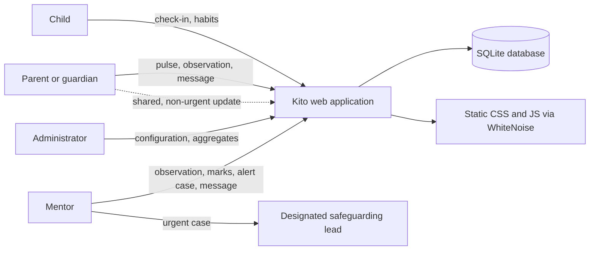
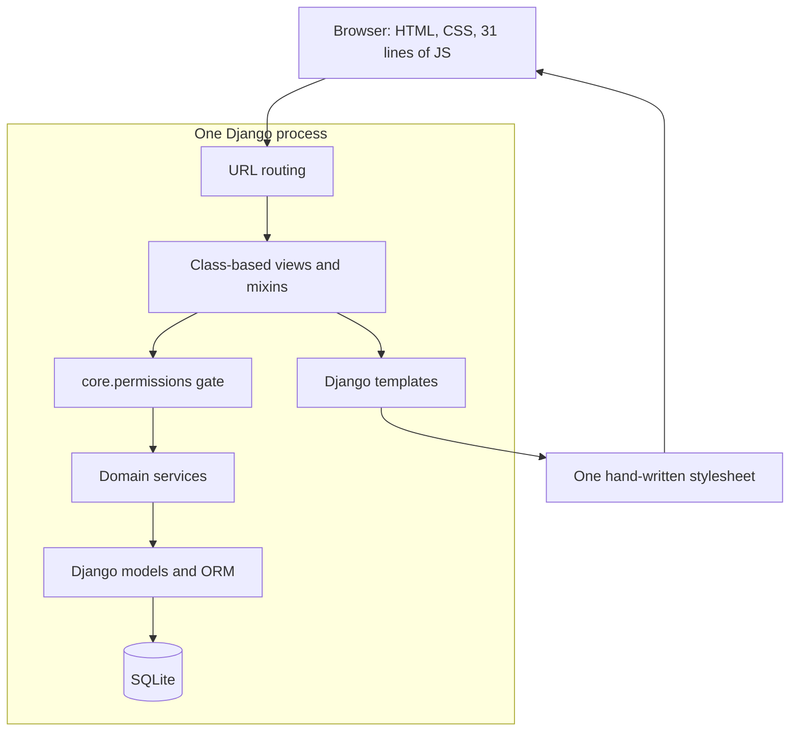
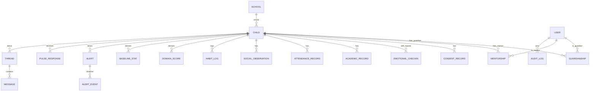
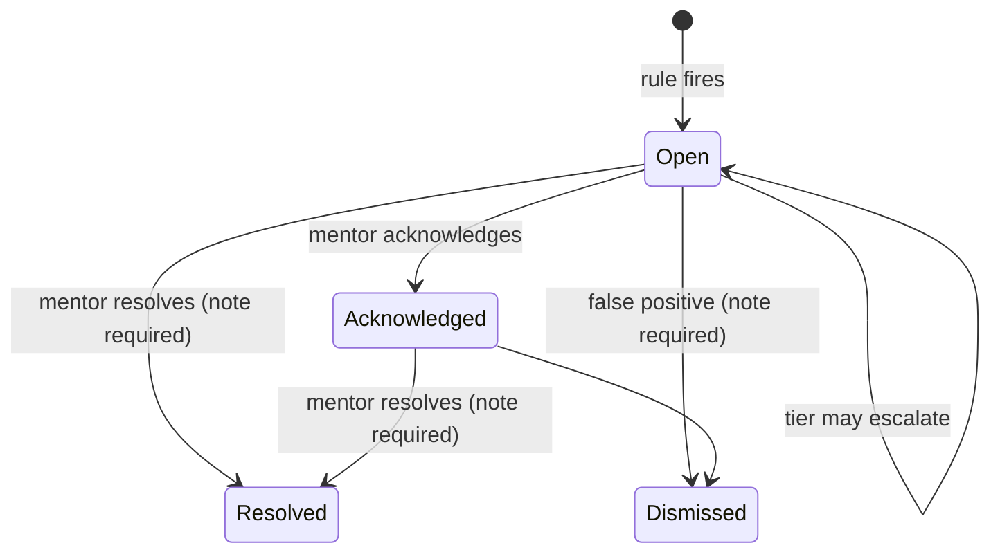

# 4. Design

## 4.1 Architectural drivers

Five requirements shape the architecture more than the rest:

- **Fail closed (NFR1, P1).** Authorisation must run before a view can query, so
  it belongs in `dispatch`, not in a helper called somewhere near the bottom.
- **Relationship, not role (FR2, P2).** The gate needs the child, not only the
  user, which rules out a purely role-based decorator.
- **Auditability (NFR3).** Reads, writes, shares and denials must leave a trail
  that survives the actor's deletion.
- **No build step (constraint, NFR11).** The browser receives HTML, one CSS file
  and one small script. There is no bundler, transpiler or package manager in the
  deploy path.
- **Free hosting (constraint).** One process, one SQLite file, static files
  served by the application.

## 4.2 System context



*Figure 4.1 — System context. The school is the only organisation; the
safeguarding lead is a named member of staff, not a separate system.*

The platform is deliberately single-tenant. There is no school selector, no
tenant column and no cross-school administrator, because the brief is one school
and multi-tenancy would add a class of isolation bugs for no benefit.

## 4.3 Layered architecture



*Figure 4.2 — Container view. The permission gate is crossed before any domain
query; services hold invariants that must survive a future second view.*

The project has seven apps. Each has one reason to change:

| App | Responsibility | Representative models |
|---|---|---|
| `core` | identity, roles, school, audit, permission matrix, mixins, health check | `User`, `School`, `AuditLog` |
| `children` | child identity, guardianship, mentorship, consent records | `Child`, `Guardianship`, `Mentorship`, `ConsentRecord` |
| `domains` | the four structured capture modules, row-level access, notes | `EmotionalCheckin`, `AcademicRecord`, `AttendanceRecord`, `SocialObservation`, `HabitLog` |
| `analytics` | scoring, baselines, SVG charts, cohort aggregates, ML benchmark | `DomainScore`, `BaselineStat`, `ModelReport` |
| `alerts` | deterministic rules, engine, safeguarding screen, case workflow | `Alert`, `AlertEvent` |
| `feedback` | weekly guardian pulse and aggregate participation | `PulseResponse` |
| `messaging` | adult-to-adult threads about a child | `Thread`, `Message`, `ThreadRead` |

Views are thin: they resolve the child, ask the gate, call a service and render.
They do not contain permission branches and they do not query a domain model for
display directly. This is what makes it possible to test access rules once rather
than once per page.

## 4.4 Data model



*Figure 4.3 — Core entities. Attendance and habit rows hang off the child; the
score and baseline tables are derived caches, not source data.*

The model separates **source records** (what a person observed) from **derived
records** (what the platform computed). That separation is the reason a score can
be deleted and rebuilt without losing evidence, and the reason a historical
figure can be explained by the method version that produced it.

Four invariants are enforced at the database or model layer, not merely in a
view:

1. one `DomainScore` per child, domain and period end;
2. one `BaselineStat` per child, domain, date and window;
3. one open alert per child and rule, and one alert per child, rule and period;
4. messages cannot be updated or deleted once written.

The child's habit log is keyed by `(child, day, source)`. A child, a guardian and
a mentor may each describe the same day; the platform keeps three rows rather
than letting the last writer erase the others.

## 4.5 Access control design

### 4.5.1 The matrix

Access is a function of four things: the user's role, their **relationship to
this child**, the resource, and the action being attempted. The matrix is a
literal dictionary in `core/permissions.py`:

```python
MATRIX = {
  (Role.PARENT, Relation.OWN): {
    Resource.EMOTIONAL: Access.READ,
    Resource.EMOTIONAL_OBSERVATION: Access.WRITE,
    Resource.ALERT: Access.SUMMARY,
    Resource.MESSAGE: Access.WRITE,
    ...
  },
  (Role.MENTOR, Relation.ASSIGNED): {...},
  (Role.CHILD, Relation.SELF): {...},
  (Role.ADMIN, Relation.INSTITUTION): {...},
}
```

Access levels are ordered (`NONE < AGGREGATE < SUMMARY < READ < WRITE < MANAGE`),
so a single comparison answers "is this enough?". There are 56 matrix entries
over 14 resources and four role/relationship rows; 38 of the entries grant access
above `NONE`. The full matrix is in Appendix A.

### 4.5.2 Resolving the relationship

`resolve_relation` answers *why* the user is connected to the child:

- **Administrator** → institution-wide;
- **Child** → self, and only for their own profile;
- **Guardian** → own child only if the guardianship is active, consent is
  recorded and consent has not been revoked;
- **Mentor** → assigned child only while the mentorship is active;
- anything else → none.

Every branch requires a *current* row. Suspending a mentorship or revoking
consent takes effect on the next request without deleting history. This is the
difference between consent as a gate and consent as a checkbox, and it was worth
a dedicated bug fix in implementation (Section 5.11).

### 4.5.3 Two gates, not one

The matrix answers "may this person open the emotional page for this child". It
cannot answer "may they see *this row*". A mentor has `SUMMARY` on emotional
wellness: they may see adult observations and check-ins the child chose to share,
never private ones. That second decision belongs to `domains/access.entries_for`,
which every list view must call.

```text
matrix gate   → may open the page / call the action
row gate      → which records inside it are visible
note filter   → whether the free-text note on a visible record is visible
```

The three layers are deliberately independent. A visible rating does not imply a
visible note, and being allowed to write an observation does not grant the right
to read someone else's.

### 4.5.4 Enforcement and audit

`ChildScopedMixin` resolves the child from the URL in `dispatch` and raises
`PermissionDenied` before the view body runs. `require_access` writes an
`AuditLog` denial for every resource in `AUDITED_RESOURCES`: 12 of the 14
resources, covering profile, emotional data, observations, academic, social,
habits, scores, alerts, case notes, messages, feedback and the audit log itself.
Consent and configuration are not audited as denials because a refusal to change
configuration is already visible in the admin log and is not a read of a child's
data. The metadata records the required level, the granted level and the
relation, but never the content the user was trying to read.

Two consequences are intentional:

- **A denial is a 403, not a redirect to the dashboard.** A redirect hides the
  refusal and makes an access-control bug look like a navigation quirk.
- **The administrator cannot read everything.** `(ADMIN, INSTITUTION)` has
  `NONE` on emotional data, observations, case notes and messages, `AGGREGATE` on
  scores, alerts, academic, social, habits and feedback, and `MANAGE` on profile,
  consent and configuration. "The person who can see everything" is a privacy
  anti-pattern, not a convenience.

### 4.5.5 Why not Django groups and permissions?

Django's built-in permissions are model-level (`add_child`, `change_alert`).
They cannot express "this mentor, this child, until the mentorship ends" without
a parallel object-level layer. Building that layer anyway, but expressing it as
data rather than `if` statements, gives three benefits: the matrix can be
rendered into the UI from the code that enforces it, it can be exhaustively
tested, and adding a resource is a one-line change rather than a search for every
role check in the codebase. The trade-off is that the project owns the
enforcement code rather than delegating it to the framework, which is why the
permission suite is one of the largest in the repository.

## 4.6 Structured capture

All four domains share an abstract base with `child`, `recorded_by`, `source`,
`occurred_on`, `note`, `note_visibility` and timestamps. The shared base gives one
audit shape and one note rule; the concrete tables give typed columns and real
constraints.

Two decisions matter:

- **The reporter is derived from the role, never selected by the form.** A mentor
  cannot file a record as a guardian, and a child cannot file an adult
  observation. The stored `source` is what the row gate uses later, so letting
  the browser choose it would make the gate decorative.
- **Note visibility is explicit.** A child can keep a note private, share it with
  mentors, or share it with all adults who already have access. The default is
  private. This lets a child write something for themselves without turning the
  check-in into a disclosure channel by accident.

Validation rejects future dates, marks above the maximum, a missing maximum, and
a completely empty habit log. Re-submitting the same day as the same reporter
updates that person's row; a second reporter is told the day is already covered
rather than silently overwriting.

## 4.7 Scoring design

### 4.7.1 Shape and normalisation

For each child, each domain and an `overall` pseudo-domain, the platform stores
one score per **rolling seven-day window**, eight windows deep (56 days). The
latest window always ends today, so a new entry is visible immediately instead of
waiting for a calendar week to close.

Every domain is reduced to a per-day value between 0 and 1 before it is combined:

| Domain | Daily value | Weight |
|---|---|---|
| Emotional | mean of mood, energy, optional sleep quality and felt connection, each `(x−1)/4` | 0.40 |
| Academic | `score / max_score` | 0.25 |
| Habits | mean of sleep against age band, activity/60, screen-time ramp, nutrition, breakfast | 0.20 |
| Social | `(rating−1)/4` | 0.15 |

The overall value for a day is the weighted mean of the domains **present that
day**, renormalised by their weights, and requires at least two domains. A child
with only emotional check-ins therefore has no overall score, and the page says
so. Averaging missing domains as zero is how a monitoring system quietly labels
an unmeasured child as unwell.

### 4.7.2 Confidence

Confidence is **coverage, not certainty**. Thresholds follow each domain's natural
cadence:

| Confidence | Emotional / habits / overall | Academic / social |
|---|---|---|
| good | ≥ 5 distinct days | ≥ 3 |
| moderate | ≥ 3 | ≥ 2 |
| thin | 1–2 | 1 |
| none | 0 (no row) | 0 (no row) |

Academic and social observations are less frequent than a daily check-in, so
holding them to the daily threshold would mark every child's academic score
"thin" forever. The threshold is per cadence, not optimism.

### 4.7.3 Baselines, gaps and versioning

A 28-day mean and population standard deviation are stored per child and domain.
The baseline is the child's **own** recent normal, not a class average, because
the population includes children whose normal is already a concern. The chart
shades that band.

An empty window produces **no row at all**. The trend then draws a gap and the
table says "no data". The alert rules treat a gap as a gap, not as a low value.

Every score row carries `method_version = "1.0"`. When the arithmetic changes, the
version changes, and a historical figure can be explained by the method that
produced it. Recompute is idempotent: the stored window is deleted and rebuilt, so
the same entries produce the same numbers.

### 4.7.4 Chart design

Charts are **server-rendered inline SVG**. The axis is fixed at 0–100, because
auto-scaling makes a two-point wobble look like a crisis. Gaps break the line;
isolated points are dots rather than segments. The same numbers appear in a
`<details>` table, so the chart is never the only way to read the data, and the
page prints to PDF without a chart library.

## 4.8 Alert design

### 4.8.1 Rules

| Rule key | Tier | Fires when |
|---|---|---|
| `overall_very_low` | urgent | two consecutive windows ≤ 35, both with moderate/good confidence |
| `overall_below_baseline` | concern | latest ≤ own 28-day mean − 1.5 SD (SD ≥ 5, sample ≥ 8) |
| `sustained_low` | concern | three consecutive windows ≤ 45, all confident |
| `declining_trend` | watch | latest is ≥ 10 points below the window three periods earlier |
| `domain_below_baseline:<domain>` | watch | a domain falls ≥ 1.5 SD below the child's own baseline |
| `multiple_domains_low` | concern | two or more domains ≤ 50 in the latest window |
| `no_recent_data` | watch | history exists in the 56-day window but none in the latest week |
| `guardian_pulse_low` | concern | two consecutive weekly pulses rate the week ≤ 2 (see 4.8.5) |
| `safeguarding_signal:<category>` | urgent | a note matches a short behavioural phrase list |

Only the most severe overall finding is kept per child per run. A child in
serious difficulty would otherwise produce four differently worded overall
alerts, which makes the queue look worse without telling the mentor more.

### 4.8.2 Lifecycle



*Figure 4.4 — Alert lifecycle. There is no automatic transition; only a person
closes a case.*

The engine:

- keeps **one rolling alert per rule per child**;
- increments `occurrences` only when `last_seen_on` differs from the evaluation
  date;
- takes the higher of the existing and new tier, never a downgrade;
- never auto-resolves;
- refuses to reopen a closed alert for the same rule and period, so a cron run
  cannot overturn a person's decision;
- runs inside a transaction with `select_for_update` so two runs cannot create
  duplicates.

### 4.8.3 Ownership and sharing

Urgent and safeguarding findings go to `School.safeguarding_lead` when one is
named and active. Otherwise assignment follows the child's active mentorships:
class teacher, mentor, counsellor, subject teacher, coach. An unassigned alert is
a notification nobody reads, so the engine always finds a person where one exists.

A non-urgent alert can be shared with guardians as an explicit mentor action, and
only when consent is active. Internal case notes and evidence stay private.
Urgent alerts are **never** shareable: a safeguarding concern is discussed with
the family by the designated lead, following the school's procedure, not by a
button in a dashboard.

### 4.8.4 Safeguarding screening without copying the text

The screen matches a short list of behavioural phrases in four categories:
self-harm, harm from others, unsafe home and neglect. On a match it raises an
urgent alert containing the **category, date, source resource and entry
reference** — never the note text. The original sentence stays in its domain
table under that domain's access rule.

This is a deliberate limit. A safeguarding queue must not become a second, less
protected copy of a child's diary, and an alert that quotes the disclosure is a
copy. Matching is word- and phrase-based; it is a safety net for a human to
triage, not a classifier, and every match is urgent because a missed disclosure
costs more than a conversation about a false positive.

### 4.8.5 Guardian pulse and the family page

A guardian submits two ratings per child per week — how the child's week was, and
how supported the family feels — plus an optional comment. A mentor assigned to
the child can read the history; the administrator sees aggregate participation
and averages only. Scoring and rules read the two ratings; the comment is for a
human, is not screened by the alert engine, and never enters the score.

Two consecutive low weekly ratings, no more than 14 days apart, raise a concern.
One difficult week is a difficult week, not a case.

The family alert page shows only updates a mentor chose to share, for the
guardian's own child, plus this week's pulse. It never shows scores, tiers, case
notes, other families or urgent safeguarding matters.

## 4.9 Messaging design

A thread belongs to one child. Its audience is the adults who are already
responsible for that child: all currently assigned mentors and all currently
consented guardians. That is a **relationship-scoped audience**, not a fixed
member list, so it updates automatically when a mentorship ends or consent is
revoked.

- Messages are append-only: `save()` refuses an update, `delete()` refuses a
  delete, and a correction is a new message.
- A mentor can close a thread; it then accepts no replies but stays readable.
- Read markers decide whether the interface says "1 new message". They are not
  authorisation.
- The child and the administrator have `MESSAGE: NONE`. A private adult-managed
  channel around a child is an unmonitored space, not support; the child's own
  channel is the check-in. Correspondence about a family is not configuration
  data.
- `messaging.admin` registers nothing, so the platform administrator cannot read
  threads through `/django-admin/`.

## 4.10 Offline ML benchmark design

The benchmark answers a narrow question: given the same structured features the
rules use, can a plain logistic regression separate labelled difficult periods
from stable ones when every held-out child is one the model has never seen?

| Aspect | Choice |
|---|---|
| Features | 13 numeric: latest and prior overall, four-week change, deviation from own baseline, four domain scores, share of domains ≤ 50, domain coverage, latest guardian wellbeing and support, missing-pulse flag |
| Excluded | all free text — notes, observations, case notes, pulse comments, messages |
| Labels | the synthetic archetype's *current* state (declining after onset, recovering before recovery, healthy throughout); sparse children excluded |
| Validation | leave-one-child-out by child, not by snapshot |
| Model | ridge-penalised logistic regression fitted by IRLS in pure Python, fixed L2 = 0.05, threshold 0.5 |
| Output | one aggregate `ModelReport`; no child id, no per-child prediction, no production connection |

The design choice to avoid scikit-learn is not anti-library. It keeps the deploy
free of a compiled dependency, makes the numerical method inspectable in the
report, and keeps the artefact small enough to audit. The cost is that the
implementation is slower and less general than a library, which is acceptable for
an offline command run once per reseed.

## 4.11 Interface and interaction design

Navigation is role-specific. A child sees **Check in**, **My habits** and their
own profile; a mentor sees **Children**, **Alerts**, **Messages** and their pulse
history; a guardian sees their child, **Messages**, the family alert page and the
pulse; the administrator sees **Cohort**, **Alerts**, **Pulse**, **Model**,
**Access matrix** and configuration. A link that would be refused is not
rendered, but the gate is still enforced if the URL is typed.

| Area | Representative routes |
|---|---|
| Shared | `/`, `/login/`, `/logout/`, `/dashboard/`, `/healthz/` |
| Child | `/checkin/`, `/children/<id>/domains/<module>/` |
| Mentor | `/children/<id>/`, `/children/<id>/wellness/`, `/children/<id>/emotional/observe/`, `/children/<id>/domains/<module>/new/`, `/alerts/`, `/alerts/<id>/`, `/messages/` |
| Guardian | `/children/<id>/`, `/children/<id>/wellness/`, `/children/<id>/pulse/`, `/alerts/family/`, `/messages/` |
| Administrator | `/cohort/wellness/`, `/cohort/alerts/`, `/cohort/pulse/`, `/cohort/model/`, `/admin/permissions/`, `/django-admin/` |

The visual system is one hand-written stylesheet with custom properties for
colour, spacing and type. Cards, badges and tables are plain semantic HTML. The
31-line script does three non-essential things: confirm destructive actions,
dismiss flash messages after six seconds, and fill a "now" label. Every page
works with JavaScript disabled.

Accessibility intent: labelled inputs, visible focus, semantic headings, no
colour-only status, 44-pixel touch targets, and text alternatives for charts. A
chart has a table behind `<details>`; a confidence label is text, not a colour
dot. Sections 6.11 and 7.5 record what was and was not verified.

## 4.12 Security design

The threat model follows the OWASP Top 10 categories (OWASP Foundation, 2021),
adapted to a server-rendered Django application.

| Threat | Control |
|---|---|
| Spoofing | Django authentication; session cookie `HttpOnly`, `Secure`, `SameSite=Lax`; audited login/logout |
| Tampering | server-side validation; CSRF middleware; append-only alert events and messages; database uniqueness constraints |
| Repudiation | append-only `AuditLog` with actor, role snapshot, IP, user agent, resource and metadata; actor deletion leaves a null actor plus the role |
| Information disclosure | relationship-aware matrix; row gate; note filter; aggregate-only admin; no uploads; `X-Frame-Options: DENY`; `nosniff`; referrer policy |
| Denial of service | out of scope for a single-school deployment; the free host provides basic protection |
| Elevation of privilege | role stored server-side and never accepted from a form; permission checks in `dispatch`; messaging models absent from Django admin |

`python manage.py check --deploy` reports exactly two warnings, both understood:
`SECURE_HSTS_SECONDS` and `SECURE_SSL_REDIRECT` are intentionally not set because
the host terminates TLS and a misread redirect setting behind a proxy causes a
worse failure than the warning it silences. This reasoning is documented in the
settings file so it survives the project.

Two honest limitations belong here rather than in a footnote. First, an
authenticated user can distinguish "no such child" (404) from "a child you may
not see" (403). Within one school where pupils are known to one another this is
low risk, but it is a deliberate trade-off in favour of auditable refusals.
Second, SQLite serialises writes; a large school or a background job that runs
during the school day would need PostgreSQL, which the ORM makes a configuration
change rather than a rewrite.

## 4.13 Key interaction: entry to human review

```mermaid
sequenceDiagram
  actor C as Child
  participant V as Check-in view
  participant G as Permission gate
  participant D as Domain table
  participant S as Scoring
  participant R as Rule engine
  actor M as Mentor / lead
  C->>V: POST ratings and optional note
  V->>G: require WRITE on emotional data
  G-->>V: allow only if consent is active
  V->>D: save check-in
  V->>R: screen note for safeguarding phrases
  R-->>M: urgent alert if a category matches
  V->>S: ensure_child_current
  S->>S: rebuild rolling windows and baseline
  V-->>C: confirmation, no score shown
  Note over M: Alert carries evidence and an owner;<br/>the note text stays in the domain table.
```

*Figure 4.5 — A check-in may produce a score and an urgent alert, but the child
never sees either. The note is screened, not copied.*

## 4.14 Design alternatives

| Decision | Chosen | Alternative | Why |
|---|---|---|---|
| Framework | Django 5.2 | Flask / FastAPI | auth, ORM, migrations, forms, CSRF and templates are already coherent; fewer custom security primitives |
| Rendering | server-rendered | SPA | no build step, printable, accessible by default, fast on a free host |
| Authorisation | declarative matrix | Django groups | groups cannot express "this child, this mentor, until the assignment ends" |
| Data model | shared base + typed tables | one generic JSON table | real columns, constraints and indexes; better queries and clearer code |
| Database | SQLite | PostgreSQL | zero configuration on the free host; documented migration path |
| Scoring window | rolling 7 days | calendar week | a new entry appears immediately; no Monday cliff |
| Detection | deterministic rules | classifier | explainable, testable, no training data required |
| ML | pure-Python IRLS | scikit-learn | no compiled deploy dependency; method visible in the report |
| Charts | server SVG | chart library | no JS dependency, print-friendly, table alternative |
| Uploads | none | attachments | removes a malware and moderation surface the project cannot defend |

## 4.15 Summary

The design keeps one idea in the centre: **a monitoring system is an access-control
system with a dashboard attached**. The matrix decides who may look, the row gate
decides what they may see, the scoring method refuses to invent data, the alert
engine refuses to decide on a person's behalf, and the ML layer is measured but
never wired into care.
