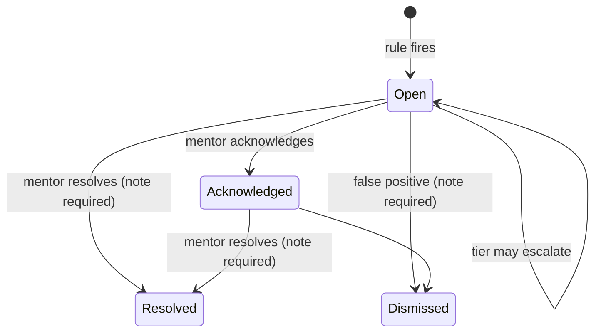

# Appendices

## Appendix A — Permission matrix

Access levels are ordered: `NONE < AGGREGATE < SUMMARY < READ < WRITE < MANAGE`.
The table is generated from `core/permissions.py`; it is the same data the gate
uses at runtime, so it cannot drift from behaviour. There are 56 entries over 14
resources, 38 of which grant access above `NONE`.

Key: **N** = none, **A** = aggregate, **S** = summary, **R** = read,
**W** = write, **M** = manage.

| Resource | Parent (own) | Mentor (assigned) | Child (self) | Admin (institution) |
|---|---|---|---|---|
| Profile | R | R | R | M |
| Consent | M | N | S | M |
| Emotional wellness | R | S | W | N |
| Emotional observation | W | W | N | N |
| Academic | R | W | S | A |
| Social | R | W | S | A |
| Habits | W | W | W | A |
| Score | R | R | N | A |
| Alert | S | W | N | A |
| Case note | N | W | N | N |
| Feedback (pulse) | W | W | N | A |
| Message | W | W | N | N |
| Audit log | N | N | N | R |
| Configuration | N | N | N | M |

Reading the matrix by row explains the design:

- **Emotional wellness** is the most sensitive content resource. The parent can
  read their own child's rows; the mentor gets a summary (observations plus
  shared check-ins, never private notes); the child can write their own check-in;
  the administrator gets nothing.
- **Emotional observation** is an adult write. A child can never create or read
  one about themselves.
- **Score** is readable by the adults who support the child, refused to the child
  and aggregate-only for the administrator.
- **Alert** is a summary for the parent (shared, non-urgent updates only), a full
  case for the mentor, and aggregate for the administrator. Case notes are never
  visible outside the mentor relationship.
- **Message** is adult-to-adult only. The child and administrator are `NONE`.
- **Consent** is manageable by the parent and the administrator. The child gets
  `SUMMARY`, which means they can see that consent exists and its state, not edit
  the record.
- **Audit log** is readable by the administrator but not writable by anyone
  through the application.

The row gate sits below this table. A mentor with `SUMMARY` on emotional data
sees adult observations and self-reports whose `note_visibility` is `MENTOR` or
`ALL`; a private note is filtered even though the record is visible. A child sees
only their own self-reports and never an adult observation about them.

## Appendix B — Scoring method (version 1.0)

### B.1 Notation

- `x` — a 1–5 rubric rating.
- `r(x) = clamp((x − 1) / 4, 0, 1)`.
- `w_d` — domain weight: emotional 0.40, academic 0.25, habits 0.20, social 0.15.
- A **day value** is in [0, 1]; a **window score** is in [0, 100].

### B.2 Daily values

| Domain | Daily value for one reporter |
|---|---|
| Emotional | mean of `r(mood)`, `r(energy)`, and `r(sleep_quality)` / `r(felt_connected)` when present |
| Academic | `clamp(score / max_score, 0, 1)` |
| Social | `r(rating)` |
| Habits | mean of the habit components present (below) |

Habit components:

- **Sleep** — 1.0 inside the age band, otherwise a three-hour ramp to 0:
  `clamp((hours − (low − 3)) / 3)` below the band and
  `clamp(1 − (hours − high) / 3)` above it. Bands: early years 10–13 h,
  primary 9–12 h, early secondary and secondary 8–10 h, unknown 9–12 h.
- **Activity** — `clamp(minutes / 60, 0, 1)`.
- **Recreational screen time** — 1.0 at ≤ 60 min, then
  `clamp(1 − (minutes − 60) / 180, 0, 1)`; four hours scores zero.
- **Nutrition** — `r(nutrition_quality)`.
- **Breakfast** — 1.0 if eaten, 0.0 otherwise.

When several reporters describe the same day in the same domain, the day value
is the mean of their values. Habit rows are stored per `(child, day, source)`, so
three reporters produce three rows and one averaged day value.

### B.3 Weekly windows

`periods(as_of, 8)` returns eight consecutive 7-day windows ending on `as_of`,
oldest first. The latest window always ends today, so a new entry is visible
immediately.

For each domain `d` and window `W`:

```text
sample = [day_value(d, day) for day in W if the day has data]
if sample is empty: write no row
score(d, W) = round(100 * mean(sample), 2)
data_points(d, W) = len(sample)
```

No row is the representation of absence. There is no implicit zero.

### B.4 Overall score

For each day, combine only the domains present that day:

```text
present = [(w_d, day_value(d, day)) for d in domains if day has d]
if len(present) < 2: no overall value for that day
overall_day = sum(w_d * value) / sum(w_d)
```

The overall window score is then the mean of the overall day values in the
window, ×100. A child with only one domain has no overall score, and the
interface says so instead of showing a low number.

### B.5 Confidence

Confidence is **coverage**, not statistical certainty. Let `n` be the number of
distinct days with data in the window.

| Domain | Good | Moderate | Thin | None |
|---|---|---|---|---|
| Emotional, habits, overall | n ≥ 5 | n ≥ 3 | 1–2 | 0 |
| Academic, social | n ≥ 3 | n ≥ 2 | 1 | 0 |

The per-cadence threshold exists because academic and social observations are
naturally less frequent than a daily check-in.

### B.6 Personal baseline

For each child and domain, over the 28 days ending `as_of`:

```text
mean = 100 * mean(day_values)
stddev = 100 * population_stddev(day_values)   # null when only one day
sample_size = number of days with data
```

Rules use `max(stddev, 5.0)` as the denominator, so a very stable child does not
produce enormous z-scores from a two-point change. The baseline is the child's
own recent normal, never a class average.

### B.7 Versioning and idempotence

Every row carries `method_version = "1.0"`. Recompute deletes the child's stored
scores and baselines and rebuilds them inside a transaction, so the same raw
entries always produce the same rows. Changing the arithmetic requires a new
method version; changing a threshold in `settings.py` does not, because thresholds
are configuration rather than method.

## Appendix C — Alert rules

Severity order: `watch < concern < urgent`. The engine keeps one rolling alert per
rule per child and never downgrades an open alert.

| Rule key | Tier | Exact condition | Notes |
|---|---|---|---|
| `overall_very_low` | urgent | two consecutive overall windows ≤ 35, both with confidence ≥ moderate | one week is not enough |
| `overall_below_baseline` | concern | latest overall ≤ own 28-day mean − 1.5 SD, with SD ≥ 5 and sample ≥ 8 | compares child with self |
| `sustained_low` | concern | three consecutive overall windows ≤ 45, all with confidence ≥ moderate | sustained, not a blip |
| `declining_trend` | watch | latest overall is ≥ 10 points below the window three periods earlier | direction, not level |
| `domain_below_baseline:<domain>` | watch | domain score ≤ own baseline mean − 1.5 SD | one alert per domain |
| `multiple_domains_low` | concern | two or more domains ≤ 50 in the latest window | breadth of difficulty |
| `no_recent_data` | watch | history exists in the 56-day window but no data in the latest week | a gap is a gap, not a decline |
| `guardian_pulse_low` | concern | two consecutive weekly pulses rate the week ≤ 2, ≤ 14 days apart | pulse ratings only |
| `safeguarding_signal:<category>` | urgent | a note matches a phrase in the category list | stores category + entry reference, never text |

Only the most severe overall finding is kept per child per run. Domain findings
are kept separately because they tell the mentor which dimension moved.

Safeguarding categories: self-harm, harm from others, unsafe home, neglect. Every
match is urgent, because a false positive costs a conversation and a missed
disclosure costs more. The matched text is never stored on the alert.

Engine invariants:

1. `(child, rule_key)` has at most one open alert.
2. `(child, rule_key, period_end)` is unique, so a re-run on the same day does
   not duplicate or increment.
3. `occurrences` increments once when the evaluation date advances.
4. Tier is `max(existing, new)` while open.
5. A closed alert is not reopened for the same period.
6. No automatic resolution: a person closes a case.
7. Urgent and safeguarding findings prefer `School.safeguarding_lead`.
8. Urgent alerts cannot be shared with guardians.

## Appendix D — Test inventory

`python manage.py test` — 270 tests, 62.8 seconds, all passing.

| Module | Tests | Test classes |
|---|---:|---|
| `core/tests/test_permissions.py` | 31 | `RelationshipTests`, `MatrixTests`, `InstitutionAccessTests`, `VisibleChildrenTests`, `EnforcementTests`, `AuditTests` |
| `core/tests/test_views.py` | 9 | `PublicPagesTests`, `RoleDashboardTests` |
| `domains/tests.py` | 59 | `EntriesForTests`, `DetailPageTests`, `EmotionalListTests`, `ChildCheckinTests`, `ObservationTests`, `EntryFormTests`, `HabitEntryTests`, `MatrixExtensionTests` |
| `analytics/tests.py` | 7 | `SeedDemoTests` |
| `analytics/test_scoring.py` | 25 | `DailyValueTests`, `WeeklyScoreTests`, `RecomputeTests`, `CohortSnapshotTests` |
| `analytics/test_charts.py` | 9 | `LineChartTests` |
| `analytics/test_views.py` | 20 | `ChildWellnessAccessTests`, `CohortWellnessAccessTests`, `DetailPageLinkTests` |
| `analytics/test_ml.py` | 25 | `LabelTests`, `FeatureTests`, `DatasetTests`, `TrainingTests`, `EvaluationTests`, `ModelReportViewTests` |
| `alerts/tests.py` | 31 | `RuleTests`, `EngineTests`, `SafeguardingTests`, `ServiceTests`, `AlertViewTests` |
| `feedback/tests.py` | 16 | `PulseSubmissionTests`, `PulseVisibilityTests`, `PulseRuleTests` |
| `messaging/tests.py` | 38 | `PermissionMatrixTests`, `InboxTests`, `ThreadAccessTests`, `AppendOnlyTests`, `ClosedThreadTests`, `StartThreadTests`, `AdminRegistrationTests` |
| **Total** | **270** | |

Commands used in the evaluation:

```bash
python manage.py test
python manage.py makemigrations --check
python manage.py check --deploy
python manage.py seed_demo --reset
python manage.py backtest_alerts --weeks 8
python manage.py ml_report
python manage.py cohort_report
python scripts/check_compat.py
```

## Appendix E — Route and resource map

| Route | Role | Resource gate |
|---|---|---|
| `/`, `/login/`, `/logout/`, `/healthz/` | any / anonymous | public, auth or health |
| `/dashboard/` | all | role-specific |
| `/checkin/` | child | emotional write, child resolved from session |
| `/children/<id>/` | adult with relationship | profile read |
| `/children/<id>/wellness/` | parent, mentor | score read |
| `/children/<id>/<domain>/` | per matrix | domain-specific read/summary |
| `/children/<id>/<domain>/new/` | per matrix | domain-specific write |
| `/children/<id>/emotional/observe/` | mentor, parent | emotional observation write |
| `/children/<id>/pulse/` | parent | feedback write |
| `/children/<id>/pulse/history/` | parent, mentor | feedback read/summary |
| `/alerts/` | mentor, admin (aggregate) | alert write/aggregate |
| `/alerts/<id>/` | assigned mentor | alert write |
| `/alerts/family/` | parent | alert summary |
| `/cohort/wellness/`, `/cohort/alerts/`, `/cohort/pulse/` | admin | score/alert/feedback aggregate |
| `/cohort/model/` | admin | aggregate benchmark |
| `/messages/`, `/messages/<id>/`, `/children/<id>/messages/new/` | parent, mentor | message write |
| `/admin/permissions/` | admin | configuration manage |
| `/django-admin/` | staff | Django admin; messaging models absent |

## Appendix F — Glossary

| Term | Meaning in this report |
|---|---|
| **Aggregate** | counts, averages or distributions with no child named or individually readable |
| **Alert** | a persisted finding that a named person must review; not a diagnosis |
| **Append-only** | rows may be created but not updated or deleted; corrections are new rows |
| **Baseline** | the child's own 28-day mean and spread for a domain |
| **Concern** | the middle alert tier; requires mentor follow-up |
| **Confidence** | a coverage label (thin, moderate, good), not statistical certainty |
| **Consent gate** | access is refused unless a current, unrevoked consent record exists |
| **Domain** | one of emotional, academic, social or habits |
| **Fail closed** | anything not explicitly granted is denied |
| **Gap** | a window with no data; represented as no row, never as zero |
| **Guardian pulse** | a weekly parent rating of the child's week and the family's support |
| **IRLS** | iteratively reweighted least squares, the fitting method for the logistic regression |
| **LOOCV** | leave-one-child-out cross-validation |
| **Matrix** | the `(role, relation) × resource → access` table in `core/permissions.py` |
| **Mentor** | a teacher, counsellor or other staff member assigned to a child |
| **Method version** | the version stamp on a score, so historical arithmetic is explainable |
| **Overall** | the weighted combination of at least two domains present on a day |
| **Relation** | why a user is connected to a child: own, assigned, self or institution |
| **Row gate** | the filter deciding which records inside a page are visible |
| **Safeguarding lead** | the named staff member who owns urgent findings |
| **Summary** | a reduced view: counts, observations and shared content, never private notes |
| **Urgent** | the highest alert tier; never shareable with guardians through the platform |
| **Watch** | the lowest alert tier; a signal for a human to review, not an accusation |
| **Window** | a rolling 7-day period ending on the evaluation date |

## Appendix G — Regenerating the diagrams

Every diagram in Chapter 4 is written in Mermaid and lives in
`docs/report/05-design.md`. GitHub renders it directly. For Word, paste each
block into <https://mermaid.live> and export PNG at 2x.

The two sources a marker is most likely to ask about are reproduced here.

Alert lifecycle:



Entry to human review:

```mermaid
sequenceDiagram
  actor C as Child
  participant V as Check-in view
  participant G as Permission gate
  participant D as Domain table
  participant S as Scoring
  participant R as Rule engine
  actor M as Mentor / lead
  C->>V: POST ratings and optional note
  V->>G: require WRITE on emotional data
  G-->>V: allow only if consent is active
  V->>D: save check-in
  V->>R: screen note for safeguarding phrases
  R-->>M: urgent alert if a category matches
  V->>S: ensure_child_current
  S->>S: rebuild rolling windows and baseline
  V-->>C: confirmation, no score shown
  Note over M: Alert carries evidence and an owner;<br/>the note text stays in the domain table.
```

## Appendix H — Reproduction checklist

1. `git clone https://github.com/maaz-2006/child-wellness.git`
2. Create a virtual environment and `pip install -r requirements.txt`.
3. `python manage.py migrate`
4. `python manage.py seed_demo --reset`
5. `python manage.py test`
6. `python manage.py runserver`, then sign in with a demo account.
7. For the public artefact: <https://Maaz2006.pythonanywhere.com>

The seeded accounts use the demo password `kito-demo-2026`. The superuser
account used for the live admin checks has a separate password and is not part of
the repository. No real personal data is present in either database.
